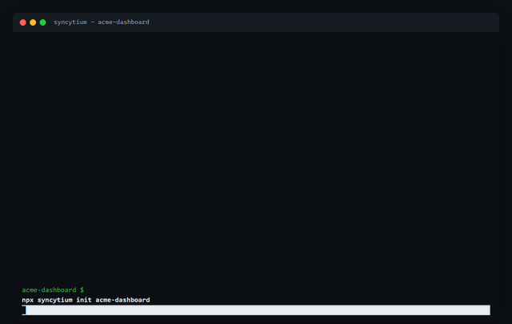
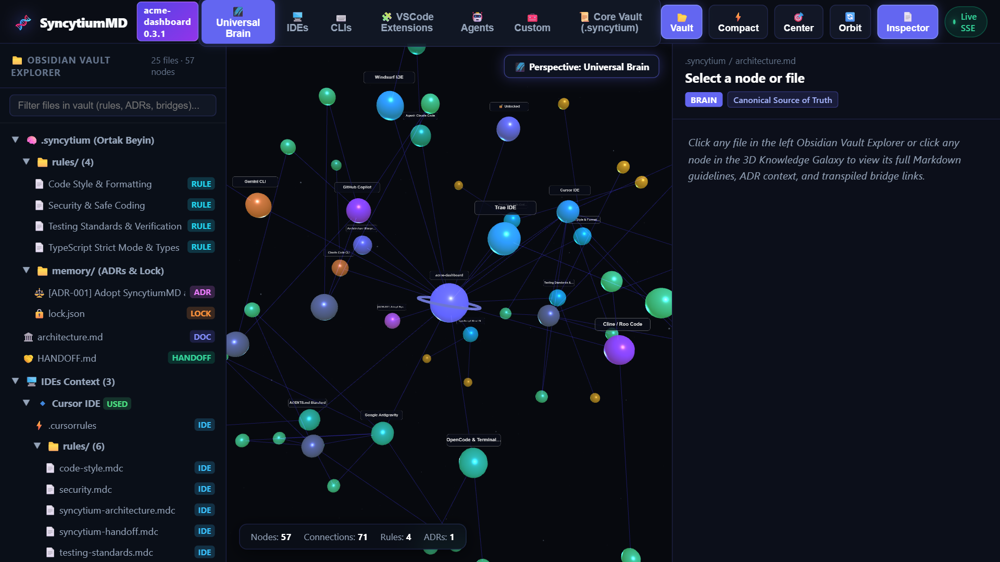

<div align="center">

# 🧬 SyncytiumMD

**One context. Every AI coding tool. Coordinated agents. Zero drift.**

*AGENTS.md is the instruction standard. SyncytiumMD is the workflow
infrastructure around it.*

[](https://www.npmjs.com/package/syncytium-md)
[](https://github.com/mrcbrbn5361/SyncytiumMD/actions/workflows/syncytium.yml)
[](https://registry.modelcontextprotocol.io/)
[](https://nodejs.org)
[](./LICENSE)
[](./CONTRIBUTING.md)

[English](./README.md) · [Türkçe](./README.tr.md)

</div>

---



*One `init` scaffolds `.syncytium/`, `sync` generates 25 bridge files across
every tool, `handoff` passes the baton, and `diff --check` fails CI the moment a
generated file drifts from the source of truth.*

---

## The problem

You use **Cursor** at work, **Claude Code** in the terminal, **Copilot** in
pull requests, and three CLI agents on CI. Each one wants its own instruction
file. So you maintain four copies of the same rules, they drift, and no agent
knows what the others did yesterday.

## The idea

Keep the rules **once**, in `.syncytium/`, and *transpile* them into every
tool's native format.

```
.syncytium/          canonical, human-authored, git-tracked
  rules/*.md         code style, security, testing, architecture, …
  memory/decisions.md  ADRs — why the project is the way it is
  HANDOFF.md         live agent baton: who has it, what's next
        │
        │  syncytium sync
        ▼
CLAUDE.md   AGENTS.md   GEMINI.md   AGENT.md   CONVENTIONS.md
.cursorrules   .clinerules   .roomodes   .windsurfrules   .traerules
.cursor/rules/*.mdc          .gemini/antigravity/rules/*.md
.github/copilot-instructions.md + .github/instructions/*.instructions.md
```

Every generated file carries a banner saying where it came from, and
`syncytium diff --check` fails your CI if any of them drift. `syncytium clean`
removes only banner-tagged files — your hand-written rules are never touched.

## Why not just use AGENTS.md?

You should use AGENTS.md — it is the right standard for *shared instructions*,
and SyncytiumMD generates it for you (alongside every other format). But a
standard file cannot answer these questions:

- **Which agent has the workspace right now?** Cursor and Claude Code editing
  the same file at the same time produce silent, expensive conflicts.
- **What did the last agent actually finish — and what did it leave for me?**
- **Did someone hand-edit one generated copy and forget the others?**

SyncytiumMD is the workflow layer that answers them: a **handoff baton**, a
**lease-based lock**, and a **CI drift gate** — all local-first, all git-tracked,
all exposed as MCP tools so the agents can operate them themselves.

| Capability | AGENTS.md alone | SyncytiumMD |
|---|---|---|
| Shared instructions across tools | ✅ (one file, per-tool agents re-read it) | ✅ (25 files, every tool's native format) |
| Agent handoff with audit trail | ❌ | ✅ |
| Lease-based workspace lock | ❌ | ✅ |
| CI drift gate (real unified diffs, exit 1) | ❌ | ✅ |
| MCP server so agents self-serve | ❌ | ✅ (23 zod-validated tools) |
| Recoverable deletion of rules/ADRs | ❌ | ✅ (trash + restore) |
| 3D knowledge graph of the whole context | ❌ | ✅ |
| Reverse-import existing configs | ❌ | ✅ |

## How is this different from Rulesync, Ruler or conforme?

Those tools (and peers like them) are excellent **rules compilers**: one source,
many tool configs. SyncytiumMD generates configs too — but the bet is different:
**the hard multi-agent problem is not *formatting* instructions, it is
*coordinating the agents that read them*.** Nobody else in this space ships an
audited handoff baton, an agent-renewable workspace lease, an MCP server that
operates the canonical context itself, and a 3D view of the whole workspace
context in one CLI. Rulesync has 66 tool targets and no coordination; SyncytiumMD
has 10 adapters and the coordination the incumbents skip. If tool coverage is all
you need, use them — and `syncytium import` will happily absorb what they
generated.

## Quick start

```bash
npx syncytium init          # scaffold .syncytium/ (stack auto-detected)
npx syncytium sync          # generate every bridge file
npx syncytium graph         # open the 3D knowledge graph in your browser
```

Requires **Node.js 20+**. No global install needed; `npx` works.

## What you get

| | |
|---|---|
| **10 built-in adapters** | Cursor, Claude Code, GitHub Copilot, Cline/Roo, Antigravity, Windsurf, Trae, OpenCode, **AGENTS.md**, **GEMINI.md** |
| **Stack-aware starters** | TypeScript, JavaScript, Python, Go, **Rust**, Java, Kotlin, PHP, Ruby, .NET, Swift, Elixir, generic |
| **Multi-agent safety** | A lease-based workspace lock with heartbeat, a handoff baton, and a 100-entry audit trail |
| **Drift detection** | Real unified diffs, orphan detection, and a `--check` flag that actually exits non-zero |
| **Live 3D graph** | WebGL knowledge cosmos, vault explorer, Markdown document reader — bound to `127.0.0.1` |
| **MCP server** | 23 tools with zod-validated inputs, honest safety annotations, built-in rate limits, and recoverable deletions |
| **CI + git hooks** | `syncytium ci` and `syncytium hook install` both gate on zero drift |
| **`--json` everywhere** | Every command emits machine-readable output for agents and CI |

## Commands

Run `syncytium --help` for the full list.

### Context

| Command | What it does |
|---|---|
| `init [name]` | Scaffold `.syncytium/`. `--template <stack>`, `--force` |
| `sync` | Regenerate all bridge files. `-t/--target`, `--no-prune`, `-f/--force` |
| `watch` | Auto-sync on every change. `-a/--agent` also holds and renews the lock |
| `diff` | Show drift with real patches. **`--check`** exits 1 in CI, `--full` for complete hunks |
| `doctor` | 11 health checks, each with an actionable `fix:` hint. `--strict` |
| `lint` | Validate rules, frontmatter and ADR schema. `--fix` heals kebab-case and missing titles |
| `validate` | Validate `syncytium.config.json` and every rule against the schema. `--fix` |
| `clean` | Delete only banner-tagged files. `--dry-run` |
| `export` | One portable Markdown bundle you can paste anywhere. `--html`, `--max-rule-chars` |
| `import` | Reverse-migrate existing `CLAUDE.md`, `.cursorrules`, … into `.syncytium/`. `--dry-run` |
| `adapters` | List every registered adapter and its targets |
| `status` | One-screen project + handoff + lock summary |

### Rules & decisions

```bash
syncytium rules [query]                       # search the catalog
syncytium rule add --title "..." --body "..." # add a canonical rule
syncytium rule show <id>                      # inspect one
syncytium rule update <id> --body-file x.md   # edit in place
syncytium rule remove <id>                    # delete + prune generated files

syncytium adr list                            # architectural decisions
syncytium adr add --title "..." --context "..." \
                  --decision "..." --consequences "..."
syncytium adr show ADR-006
syncytium adr remove ADR-006
```

### Multi-agent coordination

```bash
syncytium lock acquire --agent "Cursor" --goal "Refactor auth"
syncytium lock heartbeat --agent "Cursor"    # extend the lease
syncytium lock status
syncytium lock release --agent "Cursor"

syncytium handoff -i                          # interactive wizard
syncytium handoff --from "Cursor" --to "Claude" \
  -s ready_for_review -g "Ship v1" -d "…" -t "…"
syncytium log -n 20                           # baton audit trail
```

### Guards

```bash
syncytium hook install      # block commits on drift
syncytium hook install --auto-sync   # or just re-sync on every commit
syncytium ci                # .github/workflows/syncytium.yml drift gate
syncytium ci --force        # regenerate an existing workflow
```

### Knowledge graph

```bash
syncytium graph                        # 3D WebGL cosmos + vault explorer
syncytium graph --category ide         # isolate IDE adapters
syncytium graph --compact              # hide file and tag nodes
syncytium graph --no-open --port 4000
```



*The real `syncytium graph` cosmos for a generated project: rule nodes colored
by category, adapters, generated files, handoff and ADR nodes — click any node
to open the underlying Markdown.*

The server binds to `127.0.0.1` and rejects non-loopback `Host` headers
(DNS-rebinding guard). It refuses to serve `.env*`, `*.pem`, `*.key`, `.git/**`
and other in-root secrets.

Clicking a tool in the 3D galaxy opens the **actual Markdown files** it
generates: directory targets such as `.cursor/rules/` become directory nodes
that list their `.mdc` rules, each file opens in the document panel and is
highlighted in 3D, and adapters are marked `USED` or `EMPTY` depending on
whether their targets exist on disk.

### MCP

```jsonc
{
  "mcpServers": {
    "syncytium": {
      "command": "npx",
      "args": ["--ignore-scripts", "-y", "-p", "syncytium-md@0.3.2", "syncytium-mcp"],
      "cwd": "${workspaceFolder}",
      "env": {
        "SYNCYTIUM_TOKEN": "${SYNCYTIUM_TOKEN}"
      }
    }
  }
}
```

Hardening notes: pin the exact package version instead of `@latest`, pass
`--ignore-scripts` when launching through `npx`, keep only the 3-5 MCP
connectors a workspace actually needs, and pass any short-lived, read-only
credential through the `env` block rather than command arguments.

Or `syncytium mcp` if you already have the CLI installed. The server exposes
23 tools, including `syncytium_get_context`, `syncytium_handoff`,
`syncytium_create_rule`, `syncytium_update_rule`, `syncytium_remove_rule`,
`syncytium_record_decision`, `syncytium_sync`, `syncytium_diff`,
`syncytium_doctor`, `syncytium_validate`, `syncytium_validate_fix`,
`syncytium_lock_acquire/release/status`, `syncytium_get_graph`,
`syncytium_list_trash`, `syncytium_restore` and more.
Every input is zod-validated and closed with `additionalProperties: false`;
every property is documented; every stable read tool declares an `outputSchema`
and returns matching `structuredContent`.

**Built-in MCP safety.** Every tool advertises MCP `readOnlyHint`,
`destructiveHint`, `idempotentHint` and `openWorldHint` annotations, and the
server enforces a per-tool sliding-window rate limit (for example 5 destructive
calls per minute). Destructive tools default to `dryRun: true`; deleting needs
`dryRun: false` **and** `confirm: true`. Rules and ADRs are archived under
`.syncytium/memory/trash/` before removal, so `syncytium_restore` can undo the
operation. `syncytium_doctor` is strictly read-only. These limits are enforced
server-side, so they hold even when a client ignores the annotations.

**MCP Registry.** The repository root carries a `server.json` manifest (official
`registry.modelcontextprotocol.io` format) describing the npm package, the
stdio transport and the `mcp` launch argument. The
`discoverability` workflow regenerates `llms.txt` and `llms-full.txt`, verifies
the manifest against the package (including `mcpName`), and publishes it with
GitHub OIDC - no stored secret and no manual step. A unit test pins the manifest
version to `package.json` so the registry never advertises stale metadata.

## `.syncytiumignore`

Excludes generated targets from both `sync` and `diff`. Full gitignore syntax,
including `**`, `?`, directory-only patterns and `!` negation:

```
# Don't manage these tools
.cursorrules
.github/instructions/

# Except this one
!.github/instructions/keep.md
```

## Custom adapters

Declare any tool in `syncytium.config.json` — no code required:

```jsonc
{
  "customAdapters": [
    {
      "id": "zed",
      "name": "Zed",
      "targetFile": ".rules/zed.md",
      "includeHandoff": true,
      "includeArchitecture": true
    }
  ],
  "enabledAdapters": ["cursor", "claude", "zed"]
}
```

## Library usage

```ts
import { SyncytiumEngine } from 'syncytium-md';

const engine = new SyncytiumEngine(process.cwd());
await engine.sync();
const { hasDrift, summary } = await engine.diff();
const graph = await engine.getKnowledgeGraph({ category: 'ide' });
```

## Development

```bash
npm install
npm run verify      # typecheck -> build -> test (Node 20+)
```

**Colors.** Terminal output uses `picocolors` and honors the standard [`NO_COLOR`](https://no-color.org/) and `FORCE_COLOR` environment variables: set `NO_COLOR=1` in CI or scripts to strip all ANSI color sequences, or `FORCE_COLOR=1` (with `NO_COLOR` unset) to force colored output when piping.

Demo assets are reproducible: `node scripts/record-demo.mjs` re-records the real
CLI session and the live 3D graph into `docs/assets/` (needs ffmpeg + a local
Chromium; see the header comment in the script).

See [CONTRIBUTING.md](./CONTRIBUTING.md) and
[`.syncytium/architecture.md`](./.syncytium/architecture.md).

## License

MIT © [Miraç Birben](https://github.com/mrcbrbn5361)
