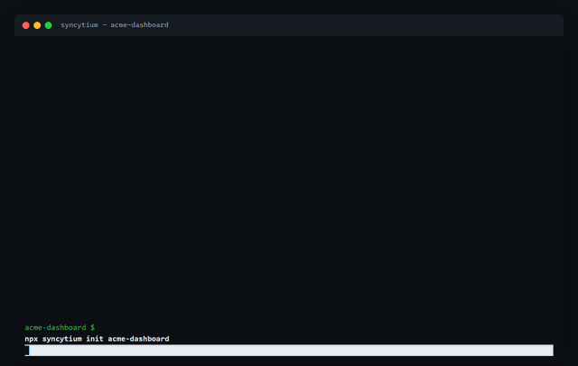
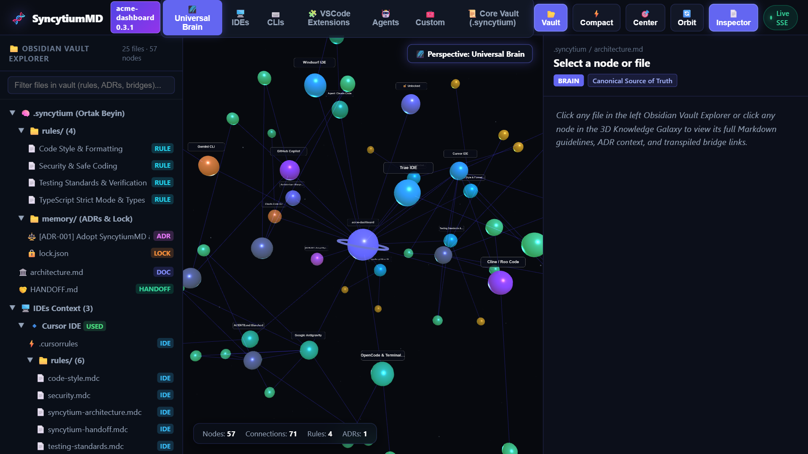

<div align="center">

# 🧬 SyncytiumMD

**Tek bağlam. Her AI kodlama aracı. Koordine ajanlar. Sıfır sapma.**

*AGENTS.md talimat standardıdır. SyncytiumMD onun etrafındaki iş akışı
altyapısıdır.*

[](https://www.npmjs.com/package/syncytium-md)
[](https://github.com/mrcbrbn5361/SyncytiumMD/actions/workflows/syncytium.yml)
[](https://registry.modelcontextprotocol.io/)
[](https://nodejs.org)
[](./LICENSE)
[](./CONTRIBUTING.md)

[English](./README.md) · [Türkçe](./README.tr.md)

</div>

---



*Tek `init` ile `.syncytium/` oluşur, `sync` her araç için 25 köprü dosyası
üretir, `handoff` sopayı devreder ve `diff --check` üretilen bir dosya kaynaktan
ayrıştığı anda CI'ı düşürür.*

---

## Problem

İşte **Cursor**'u kullanıyorsunuz, terminalde **Claude Code**, PR'larda
**Copilot** ve CI'da üç CLI ajanı. Her biri kendi talimat dosyasını istiyor.
Aynı kuralların dört kopyasını tutuyorsunuz, hepsi ayrışıyor ve hiçbir ajan
dün diğerlerinin ne yaptığını bilmiyor.

## Çözüm

Kuralları **bir kez**, `.syncytium/` içinde tutun ve her aracın kendi
biçimine *transpile* edin.

```
.syncytium/            kanonik, insan tarafından yazılan, git'te takip edilen
  rules/*.md           kod stili, güvenlik, test, mimari, …
  memory/decisions.md  ADR'ler — proje neden böyle
  HANDOFF.md           canlı ajan sopası: kimde, sırada ne var
        │
        │  syncytium sync
        ▼
CLAUDE.md   AGENTS.md   GEMINI.md   AGENT.md   CONVENTIONS.md
.cursorrules   .clinerules   .roomodes   .windsurfrules   .traerules
.cursor/rules/*.mdc          .gemini/antigravity/rules/*.md
.github/copilot-instructions.md + .github/instructions/*.instructions.md
```

Üretilen her dosya kaynağını belirten bir banner taşır ve
`syncytium diff --check` herhangi bir sapmada CI'ınızı başarısız kılar.
`syncytium clean` yalnızca banner'lı dosyaları siler — kendi yazdığınız
kurallara asla dokunmaz.

## Neden sadece AGENTS.md kullanmıyoruz?

AGENTS.md kullanmalısınız — *paylaşılan talimatlar* için doğru standarttır ve
SyncytiumMD onu da üretir (diğer tüm biçimlerle birlikte). Ama bir standart
dosya şu soruları yanıtlayamaz:

- **Şu anda workspace'in hakkı kimde?** Cursor ve Claude Code aynı dosyayı
  aynı anda düzenlerse sessiz ve pahalı çakışmalar çıkar.
- **Son ajan gerçekte neyi bitirdi — bana ne bıraktı?**
- **Birisi üretilen kopyalardan birini elle düzenleyip diğerlerini unutmuş mu?**

SyncytiumMD bu soruları yanıtlayan iş akışı katmanıdır: **handoff sopası**,
**kiralama tabanlı kilit** ve **CI sapma kapısı** — hepsi yerel öncelikli, hepsi
git'te, hepsi ajanların kendisinin kullanabilmesi için MCP aracı olarak açık.

| Yetenek | Sadece AGENTS.md | SyncytiumMD |
|---|---|---|
| Araçlar arası paylaşılan talimatlar | ✅ (tek dosya) | ✅ (25 dosya, her aracın kendi biçimi) |
| Denetim izli ajan devri | ❌ | ✅ |
| Kiralama tabanlı workspace kilidi | ❌ | ✅ |
| CI sapma kapısı (gerçek unified diff, exit 1) | ❌ | ✅ |
| Ajanların kendi kendine kullandığı MCP sunucusu | ❌ | ✅ (23 zod doğrulamalı araç) |
| Geri alınabilir kural/ADR silme | ❌ | ✅ (çöp kutusu + geri yükle) |
| Tüm bağlamın 3D bilgi grafiği | ❌ | ✅ |
| Mevcut yapılandırmaları geri içe aktarma | ❌ | ✅ |

## Rulesync, Ruler veya conforme'den farkı ne?

Bu araçlar mükemmel **kural derleyicileridir**: tek kaynak, çok araç
yapılandırması. SyncytiumMD de yapılandırma üretir — ama iddia farklı:
**zor çoklu-ajan problemi talimatları *biçimlendirmek* değil, onları okuyan
ajanları *koordine etmektir*.** Bu alanda tek CLI'da denetlenmiş bir devir
sopası, ajanın yenileyebildiği bir workspace kirası, kanonik bağlamı
kendisinin işlettiği bir MCP sunucusu ve tüm iş alanının 3D görünümünü
birlikte sunan başka kimse yok. İhtiyacınız sadece araç kapsamasıysa onları
kullanın — ve `syncytium import` onların ürettiklerini memnuniyetle devralır.

## Hızlı başlangıç

```bash
npx syncytium init          # .syncytium/ iskeletini oluştur (stack algılanır)
npx syncytium sync          # tüm köprü dosyalarını üret
npx syncytium graph         # 3D bilgi grafiğini tarayıcıda aç
```

**Node.js 20+** gerekir. Global kurulum gerekmez; `npx` yeterli.

## Neler var

| | |
|---|---|
| **10 hazır adaptör** | Cursor, Claude Code, GitHub Copilot, Cline/Roo, Antigravity, Windsurf, Trae, OpenCode, **AGENTS.md**, **GEMINI.md** |
| **Stack farkındalıklı şablonlar** | TypeScript, JavaScript, Python, Go, **Rust**, Java, Kotlin, PHP, Ruby, .NET, Swift, Elixir, genel |
| **Çoklu ajan güvenliği** | Kalp atışı olan kiralama tabanlı çalışma alanı kilidi, handoff sopası, 100 kayıtlık denetim izi |
| **Sapma tespiti** | Gerçek unified diff'ler, sahipsiz dosya tespiti ve CI'da gerçekten hata kodu döndüren `--check` |
| **Canlı 3D grafik** | WebGL bilgi kozmosu, vault gezgini, Markdown belge okuyucu — `127.0.0.1`'e bağlı |
| **MCP sunucusu** | zod doğrulamalı girdi, dürüst güvenlik etiketleri, yerleşik hız sınırları ve geri alınabilir silmeler ile 23 araç |
| **CI + git hook** | `syncytium ci` ve `syncytium hook install` ikisi de sıfır sapmayı zorunlu kılar |
| **Her yerde `--json`** | Her komut makine tarafından okunabilir çıktı üretir |

## Komutlar

Tam liste için `syncytium --help`.

### Bağlam

| Komut | Ne yapar |
|---|---|
| `init [ad]` | `.syncytium/` iskeleti. `--template <stack>`, `--force` |
| `sync` | Tüm köprü dosyalarını yeniden üret. `-t/--target`, `--no-prune`, `-f/--force` |
| `watch` | Her değişiklikte otomatik senkron. `-a/--agent` ayrıca kilidi tutar ve uzatır |
| `diff` | Gerçek yamalarıyla sapmayı göster. **`--check`** CI'da 1 döner, `--full` tam hunk'ları verir |
| `doctor` | Uygulanabilir `fix:` ipuçlarıyla 11 sağlık kontrolü. `--strict` |
| `lint` | Kuralları, frontmatter'ı ve ADR şemasını doğrular. `--fix` kebab-case ve eksik başlıkları onarır |
| `validate` | `syncytium.config.json`'u ve her kuralı şemaya karşı doğrular. `--fix` |
| `clean` | Yalnızca banner'lı dosyaları siler. `--dry-run` |
| `export` | Her yere yapıştırılabilecek tek bir taşınabilir Markdown paketi. `--html`, `--max-rule-chars` |
| `import` | Mevcut `CLAUDE.md`, `.cursorrules` vb. dosyalarını `.syncytium/` içine geri taşır. `--dry-run` |
| `adapters` | Kayıtlı tüm adaptörleri ve hedeflerini listeler |
| `status` | Proje + handoff + kilit özeti tek ekranda |

### Kurallar ve kararlar

```bash
syncytium rules [sorgu]                      # katalogda ara
syncytium rule add --title "..." --body "..."  # yeni kural ekle
syncytium rule show <id>                     # bir kuralı incele
syncytium rule update <id> --body-file x.md  # yerinde düzenle
syncytium rule remove <id>                   # sil + üretilen dosyaları temizle

syncytium adr list                           # mimari kararlar
syncytium adr add --title "..." --context "..." \
                  --decision "..." --consequences "..."
syncytium adr show ADR-006
syncytium adr remove ADR-006
```

### Çoklu ajan koordinasyonu

```bash
syncytium lock acquire --agent "Cursor" --goal "Auth refactor"
syncytium lock heartbeat --agent "Cursor"    # kirayı uzat
syncytium lock status
syncytium lock release --agent "Cursor"

syncytium handoff -i                          # etkileşimli sihirbaz
syncytium handoff --from "Cursor" --to "Claude" \
  -s ready_for_review -g "v1'i çıkar" -d "…" -t "…"
syncytium log -n 20                           # sopa denetim izi
```

### Koruma katmanı

```bash
syncytium hook install              # sapmada commit'i engelle
syncytium hook install --auto-sync  # ya da her commit'te sadece yeniden senkronla
syncytium ci                        # .github/workflows/syncytium.yml sapma kapısı
syncytium ci --force                # mevcut workflow'u yeniden üret
```

### Bilgi grafiği

```bash
syncytium graph                        # 3D WebGL kozmosu + vault gezgini
syncytium graph --category ide         # yalnızca IDE adaptörleri
syncytium graph --compact              # dosya ve etiket düğümlerini gizle
syncytium graph --no-open --port 4000
```



*Üretilmiş bir projeye ait gerçek `syncytium graph` kozmosu: kategoriye göre
renklendirilmiş kural düğümleri, adaptörler, üretilen dosyalar, handoff ve ADR
düğümleri — herhangi bir düğüme tıklayarak alttaki Markdown'u açın.*

Sunucu `127.0.0.1`'e bağlanır ve döngü dışı `Host` başlıklarını reddeder
(DNS-rebinding koruması). `.env*`, `*.pem`, `*.key`, `.git/**` gibi kök
içindeki sırları sunmayı reddeder.

3D galakside bir araca tıklamak, o aracın ürettiği **gerçek Markdown
dosyalarını** açar: `.cursor/rules/` gibi dizin hedefleri, içindeki `.mdc`
kurallarını listeleyen dizin düğümlerine dönüşür; her dosya belge panelinde
açılır ve 3D sahnede vurgulanır; adaptörler hedefleri diskte varsa `USED`,
yoksa `EMPTY` olarak işaretlenir.

### MCP

```jsonc
{
  "mcpServers": {
    "syncytium": {
      "command": "npx",
      "args": ["--ignore-scripts", "-y", "-p", "syncytium-md@0.3.2", "syncytium-mcp"],
      "cwd": "${workspaceFolder}",
      "env": {
        "SYNCYTIUM_TOKEN": "${SYNCYTIUM_TOKEN}"
      }
    }
  }
}
```

Sertleştirme notları: `@latest` yerine tam paket sürümünü sabitleyin, `npx`
ile başlatırken `--ignore-scripts` geçin, bir çalışma alanında gerçekten
ihtiyaç duyulan 3-5 MCP bağlayıcısını açık tutun ve kısa ömürlü, salt-okunur
kimlik bilgisini komut argümanları yerine `env` bloğu üzerinden iletin.

CLI zaten kuruluysa `syncytium mcp` de olur. Sunucu 23 araç sunar:
`syncytium_get_context`, `syncytium_handoff`, `syncytium_create_rule`,
`syncytium_update_rule`, `syncytium_remove_rule`, `syncytium_record_decision`,
`syncytium_sync`, `syncytium_diff`, `syncytium_doctor`, `syncytium_validate`,
`syncytium_validate_fix`, `syncytium_lock_acquire/release/status`,
`syncytium_get_graph`, `syncytium_list_trash`, `syncytium_restore` ve fazlası.
Her girdi zod ile doğrulanır ve `additionalProperties: false` ile kapatılır; her
alan belgelenir; kararlı her salt-okunur araç bir `outputSchema` bildirir ve
buna uyan `structuredContent` döndürür.

**Yerleşik MCP güvenliği.** Her araç MCP `readOnlyHint`, `destructiveHint`,
`idempotentHint` ve `openWorldHint` etiketlerini bildirir; sunucu ayrıca araç
başına kayan pencere hız sınırı uygular (örneğin dakikada 5 yıkıcı çağrı).
Yıkıcı araçlar varsayılan olarak `dryRun: true` çalışır; silme için
`dryRun: false` **ve** `confirm: true` gerekir. Kural ve ADR'ler silinmeden önce
`.syncytium/memory/trash/` altına arşivlenir; `syncytium_restore` işlemi geri
alır. `syncytium_doctor` kesinlikle salt-okunurdur. Bu sınırlar istemci
etiketleri yok saysa bile sunucu tarafında uygulanır.

**MCP Registry.** Depo kökünde resmî `registry.modelcontextprotocol.io`
formatında bir `server.json` bildirimi var; npm paketini, stdio taşımını ve
`mcp` başlatma argümanını tanımlar. `discoverability` iş akışı `llms.txt` ve
`llms-full.txt` dosyalarını yeniden üretir, bildirimi `mcpName` ile pakete karşı
doğrular ve GitHub OIDC ile yayınlar — saklı sır yok, elle adım yok. Birim testi
sürümünü `package.json`'a sabitlediği için registry asla bayat meta veri
yayınlamaz.

## `.syncytiumignore`

Üretilen hedefleri hem `sync` hem `diff` dışında bırakır. `**`, `?`,
dizin-özel kalıplar ve `!` olumsuzlaması dahil tam gitignore söz dizimi:

```
# Bu araçları yönetme
.cursorrules
.github/instructions/

# Ama bunu yönet
!.github/instructions/keep.md
```

## Özel adaptörler

Herhangi bir aracı `syncytium.config.json` içinde tanımlayın — kod gerekmez:

```jsonc
{
  "customAdapters": [
    {
      "id": "zed",
      "name": "Zed",
      "targetFile": ".rules/zed.md",
      "includeHandoff": true,
      "includeArchitecture": true
    }
  ],
  "enabledAdapters": ["cursor", "claude", "zed"]
}
```

## Kütüphane kullanımı

```ts
import { SyncytiumEngine } from 'syncytium-md';

const engine = new SyncytiumEngine(process.cwd());
await engine.sync();
const { hasDrift, summary } = await engine.diff();
const graph = await engine.getKnowledgeGraph({ category: 'ide' });
```

## Geliştirme

```bash
npm install
npm run verify      # typecheck -> build -> 114 test
```

Bkz: [CONTRIBUTING.md](./CONTRIBUTING.md) ve
[`.syncytium/architecture.md`](./.syncytium/architecture.md).

## Hikaye

Bu proje sıfır bütçeyle, bir YouTube Music uygulaması üzerinde çalışırken
doğdu. Tek yazarlı, düşük kaynaklı bir kurulumda farklı AI araçları arasında
geçiş yaparken aynı kuralları her araca ayrı ayrı kopyalamak sürdürülemez hale
geldi. Bir arkadaşın önerdiği `memory.md` fikri, bu sorunu tek bir ortak hafıza
katmanıyla çözme fikrine dönüştü: kuralları bir kez `.syncytium/` içinde tut,
her aracın kendi biçimine transpile et.

SyncytiumMD bu ihtiyaçtan çıktı: tek kaynak, çoklu ajan koordinasyonu için
handoff sopası ve kilit, sapmada CI'ı durduran `diff --check`.

## Lisans

MIT © [Miraç Birben](https://github.com/mrcbrbn5361)
