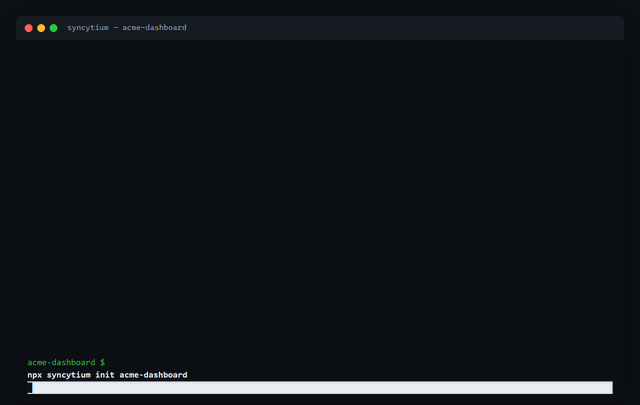

# v0.3.1 — the 3D vault grows real files, the MCP surface grows up

## Highlights

- **Real-file 3D vault** — the graph cosmos now models every generated bridge
  file as a node; directory targets (`.cursor/rules/`, `.github/instructions/`)
  become browsable directories; adapters render `USED`/`EMPTY` from actual disk
  state; clicking a file opens it in the built-in Markdown reader.
- **Structured MCP outputs** — stable read tools declare `outputSchema` and
  return matching `structuredContent`; every input schema is closed
  (`additionalProperties: false`) with documented properties; `validate`
  (read-only) and `validate_fix` (repair) are now separate tools.
- **MCP Registry** — `server.json` published to
  [registry.modelcontextprotocol.io](https://registry.modelcontextprotocol.io/)
  as `io.github.mrcbrbn5361/syncytiummd`, icons included, with `mcpName` npm
  ownership proof; publish runs on GitHub OIDC — zero stored secrets.
- `llms.txt` / `llms-full.txt` generated and published by CI.

## Verified quality gates

`npm run verify` green: typecheck, tsup build, **129 tests / 0 failures**;
`lint`, `validate`, `doctor`, `diff --check` all clean.

## Migration

No breaking changes. From 0.3.0 just `npm -g update syncytium-md` (or keep
using `npx`). If you pinned the MCP config per our README, bump the pinned
version string — nothing else moves.
